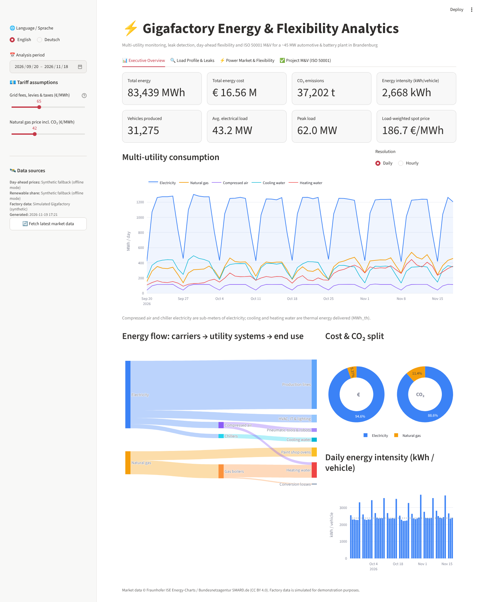
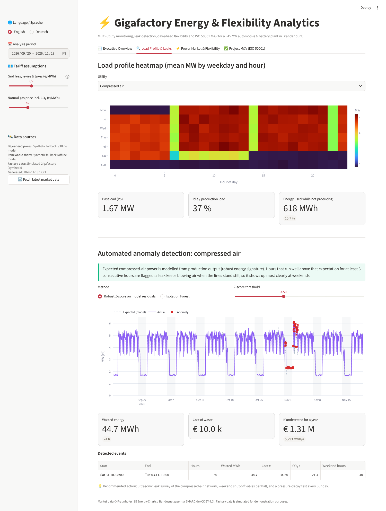
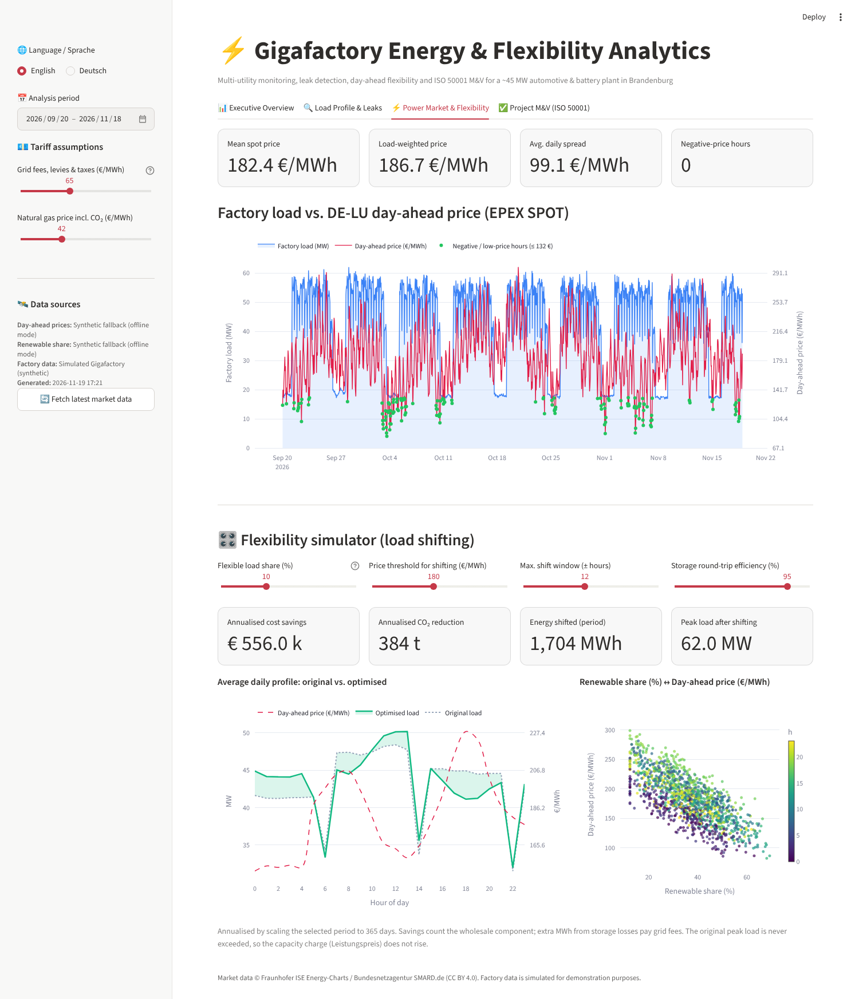
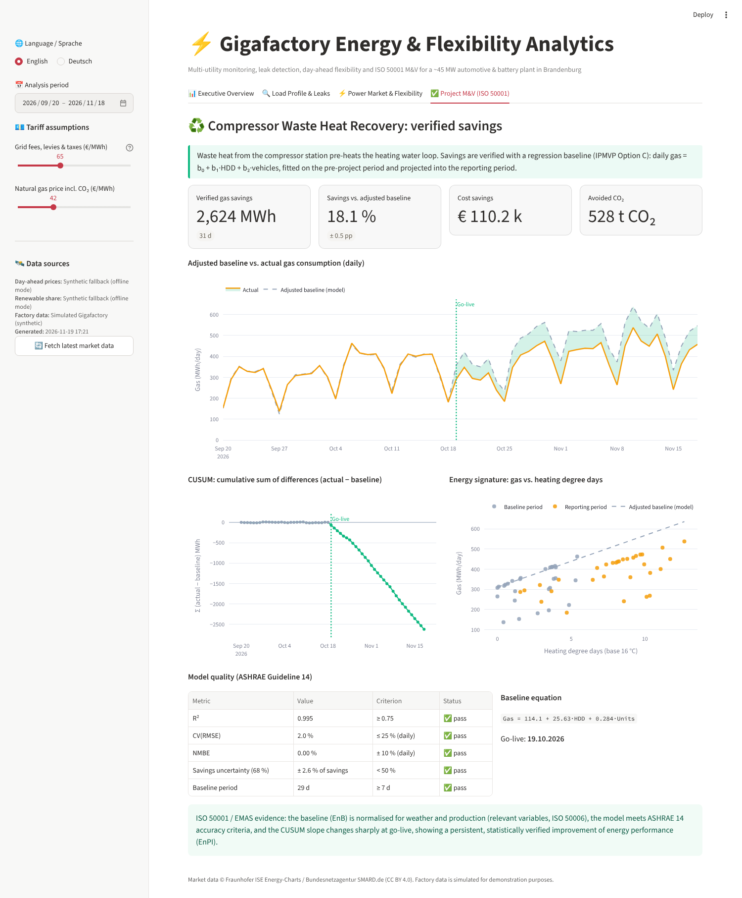
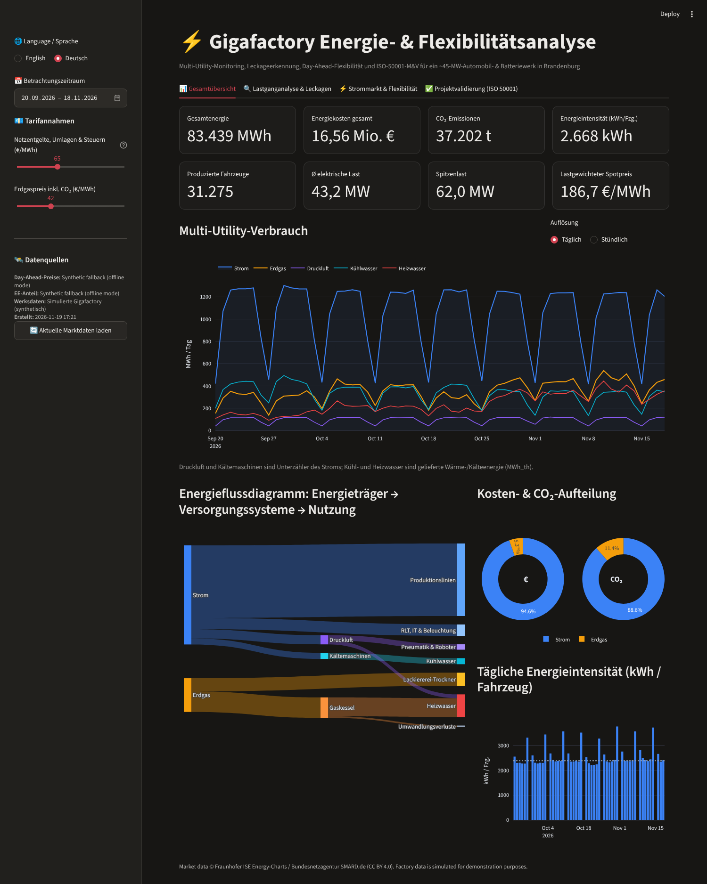
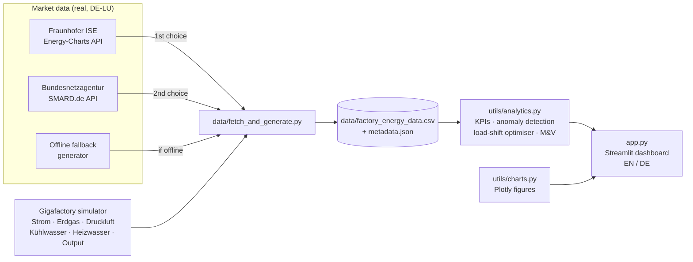

# ⚡ Gigafactory Energy & Flexibility Analytics Dashboard

**Multi-utility energy monitoring, compressed-air leak detection, day-ahead load flexibility and ISO 50001 Measurement & Verification for a ~45 MW automotive & battery Gigafactory in Brandenburg, built on real German wholesale market data.**

*Energiemonitoring, Leckageerkennung, Lastflexibilität am Day-Ahead-Markt und Projektvalidierung nach ISO 50001 für eine Gigafactory in Brandenburg.*


---

## Why this project

A Gigafactory buys as much electricity as a mid-sized city. With a pass-through spot contract, every MWh is priced hour by hour on the EPEX SPOT day-ahead auction for the **DE-LU** bidding zone, where prices regularly swing by more than 100 €/MWh within a day and fall below zero when wind and solar flood the grid. The energy team's job is to turn that volatility and the plant's own data into money and CO₂ savings:

| Question an energy manager asks | Where the dashboard answers it |
|---|---|
| How much energy, money and CO₂ does each utility cost us per vehicle? | Tab 1 · Executive overview |
| Where do we burn energy while nothing is produced? Is there a leak? | Tab 2 · Load profile & leak detection |
| What is flexible load worth on the German day-ahead market? | Tab 3 · Market & flexibility simulator |
| Did our efficiency project really save what it promised, auditor-proof? | Tab 4 · M&V for ISO 50001 / EMAS |

### Business impact found in the bundled 60-day dataset

| Finding | Result |
|---|---|
| 🔍 Weekend compressed-air leak (Sat 08:00 → Tue 10:00), found automatically | **74 h, ~45 MWh wasted**; would cost **≈ €1.3 M per year** if it stayed undetected |
| ⚡ Shifting 10 % of the electrical load away from expensive hours | **≈ €0.55 M per year** saved and **≈ 380 t CO₂ per year** avoided, with no new peak load |
| ♻️ Compressor waste heat recovery project (Abwärmenutzung) | **18.1 % gas savings verified** against a weather- and production-normalised baseline (R² 0.99, CV(RMSE) 2 %) |

> The figures above come from the dataset bundled in the repository. Re-running the pipeline pulls the latest real market prices, so the numbers move with the market. Factory data is simulated: no confidential plant data is used.

---

## See it running

**Tab 1 · Executive overview (Gesamtübersicht):** KPI cards with deltas against the previous period, multi-utility trend, Sankey energy flow, cost/CO₂ split and daily energy intensity.



**Tab 2 · Load profile & leaks (Lastganganalyse & Leckagen):** weekday × hour heatmap, baseload metrics and automated anomaly detection that pinpoints the injected weekend air leak, with wasted MWh and €.



**Tab 3 · Power market & flexibility (Strommarkt & Flexibilität):** factory load against DE-LU day-ahead prices, and a load-shifting simulator with annualised savings.



**Tab 4 · Project M&V (Projektvalidierung):** regression baseline, CUSUM and ASHRAE Guideline 14 statistics for the compressor waste heat recovery project.



<details>
<summary><b>Dark mode, German UI (Deutsch)</b></summary>



</details>

---

## Architecture



```text
gigafactory-energy-dashboard/
├── .gitignore
├── .streamlit/config.toml       # theme & server settings
├── requirements.txt
├── README.md
├── app.py                       # Streamlit dashboard (4 tabs, EN/DE, sidebar filters)
├── data/
│   ├── fetch_and_generate.py    # real DE-LU market data + synthetic Gigafactory data
│   ├── factory_energy_data.csv  # generated dataset (hourly, 60 days)
│   └── metadata.json            # data sources, engineered events, generation time
├── utils/
│   ├── analytics.py             # KPIs, anomaly detection, load-shifting optimiser, M&V
│   ├── charts.py                # Plotly visualisations (light & dark mode)
│   └── i18n.py                  # English / German UI strings
├── tests/
│   └── test_analytics.py        # pytest suite for the analytics engine
└── docs/screenshots/
```

---

## How it works

### 1. Data pipeline (`data/fetch_and_generate.py`)

**Real market data.** Hourly day-ahead prices (€/MWh) and the renewable share of German electricity load (%) for the last 60 days:

1. **Fraunhofer ISE Energy-Charts** (`/price?bzn=DE-LU`, `/public_power?country=de`). Since the market moved to 15-minute products in October 2025, quarter-hour prices are averaged to hourly values.
2. **SMARD.de** (Bundesnetzagentur) as a second source: filter 4169 for prices, generation filters for wind, PV, biomass and hydro against total load for the renewable share.
3. **Offline fallback.** If both APIs fail or rate-limit (HTTP 429 is retried with backoff), a merit-order-based generator produces realistic prices from synthetic wind and solar, so the dashboard never crashes. The source actually used is shown in the sidebar.

**Simulated Gigafactory (hourly, ~43 MW average, ~62 MW peak).**

| Utility | Model |
|---|---|
| Production output | 3-shift weekday operation (~32 vehicles/h) with handover dips, Saturday early shift, Sunday standstill |
| **Strom** (electricity) | Production lines + compressors + chillers + HVAC/IT/lighting |
| **Erdgas** (natural gas) | Paint shop ovens (production-driven) + boilers for heating water (temperature-driven) |
| **Druckluft** (compressed air) | Pneumatic tools & robots + constant system leakage. **Engineered anomaly:** a leak starting on a Saturday 08:00 that adds 15 % of the average compressed-air energy until it is repaired on Tuesday |
| **Kühlwasser** (cooling water) | Process cooling (cell formation, welding) + ambient load; chiller COP rises with free cooling in cold weather |
| **Heizwasser** (heating water) | Pretreatment/e-coat baths + space heating driven by heating degree hours |
| **M&V project** | From a Monday go-live, compressor waste heat pre-heats the heating water loop and cuts natural gas heating demand by **18 %** |
| CO₂ | Grid intensity derived hourly from the real renewable share; gas 0.201 t/MWh (UBA) |

### 2. Analytics (`utils/analytics.py`)

* **KPIs:** final energy (electricity + gas, no double counting of sub-meters), cost (spot price + grid fees/levies/taxes, gas price incl. CO₂), CO₂ and kWh per vehicle, with % deltas against the previous period of equal length.
* **Leak detection:** a robust energy signature (Huber-weighted regression of compressed-air power on production) gives the expected load. Residuals are scored with a **robust Z-score** (median/MAD) or an **Isolation Forest** (scikit-learn). Runs of at least 3 hours are grouped into events with wasted MWh, € and t CO₂. Because a leak blows regardless of production, it stands out most at weekends.
* **Load-shifting optimiser:** greedy day-ahead arbitrage. Up to *x* % of the load in hours above the price threshold moves to the cheapest hours within ± *n* hours, limited by sink capacity, the existing peak load (so the capacity charge, *Leistungspreis*, cannot rise) and storage round-trip losses. Results are annualised to 365 days.
* **M&V (IPMVP Option C):** daily gas = b₀ + b₁·HDD + b₂·vehicles, fitted on the baseline period, projected into the reporting period. Savings = adjusted baseline − actual, with **CUSUM**, **R²**, **CV(RMSE)**, **NMBE** and the fractional savings uncertainty from **ASHRAE Guideline 14**, the evidence an ISO 50001 auditor or EMAS verifier expects for EnPI improvements.

### 3. Dashboard (`app.py`)

* Sidebar: language toggle (English/Deutsch, incl. German number format), date range, tariff sliders (grid fees, gas price), data source panel and a **"Fetch latest market data"** button.
* `st.cache_data` on every expensive step; the cache key follows the CSV file's timestamp, so a refresh is picked up immediately.
* On each server start, if the bundled data uses the fallback generator or is more than 3 days old, the app tries once to pull fresh real data (disable with `GIGAFACTORY_AUTO_REFRESH=0`).
* Plotly charts use Streamlit's theme, so they look right in light **and** dark mode.

---

## Glossary · Glossar (English ↔ Deutsch)

| Deutsch | English | Meaning in this dashboard |
|---|---|---|
| **Lastgang** | Load profile | Time series of power demand (here hourly MW); the basis of every analysis in Tab 2 |
| **Grundlast** | Baseload | Load that never switches off, measured as the 5th percentile. High Grundlast at weekends points to waste |
| **Day-Ahead-Markt** | Day-ahead market | EPEX SPOT auction at noon for each hour/quarter-hour of the next day; sets the DE-LU spot price |
| **Spitzenlastkappung** | Peak shaving | Lowering the highest 15-min demand to cut the capacity charge (*Leistungspreis*) of the grid fee |
| **Abwärmenutzung** | Waste heat recovery | Re-using heat from compressors or processes, here to pre-heat heating water (Tab 4) |
| Lastverschiebung / Lastflexibilität | Load shifting / demand flexibility | Moving consumption in time to cheaper, greener hours (Tab 3) |
| Leckage | Leak | Unintended loss of compressed air; typically 20–30 % of compressor output in industry |
| Druckluft | Compressed air | One of the most expensive utilities: only ~10 % of the electrical input becomes useful work |
| Kühlwasser / Heizwasser | Cooling water / heating water | Hydronic loops that distribute cold and heat to the halls and processes |
| Energieintensität | Energy intensity | kWh per vehicle; the plant-level energy performance indicator |
| EnPI (Energieleistungskennzahl) | Energy performance indicator | Metric used in ISO 50001 to track energy performance |
| EnB (energetische Ausgangsbasis) | Energy baseline | Reference consumption, normalised for relevant variables (ISO 50006) |
| Heizgradtage | Heating degree days | Weather variable used to normalise heating energy |
| Netzentgelte, Umlagen, Stromsteuer | Grid fees, levies, electricity tax | Non-commodity part of the industrial electricity price |
| Messung & Verifizierung (M&V) | Measurement & Verification | Proving savings against an adjusted baseline (IPMVP) |
| EE-Anteil | Renewable share | Share of load covered by wind, solar, biomass and hydro |
| EMAS | Eco-Management and Audit Scheme | EU environmental management scheme with a verified environmental statement |

---

## Run it locally

Requires Python 3.10 or newer.

```bash
git clone https://github.com/PawanShetty-9/gigafactory-energy-dashboard.git
cd gigafactory-energy-dashboard

python -m venv .venv
# Windows:      .venv\Scripts\activate
# macOS/Linux:  source .venv/bin/activate
pip install -r requirements.txt

# Optional: refresh the dataset with the latest real DE-LU market data
python data/fetch_and_generate.py            # 60 days, Energy-Charts → SMARD → fallback
python data/fetch_and_generate.py --days 30  # shorter history
python data/fetch_and_generate.py --offline  # no internet needed

streamlit run app.py
```

The dashboard opens at <http://localhost:8501>.

Run the tests:

```bash
pip install pytest
pytest -q
```

## Deploy on Streamlit Community Cloud (free)

1. Push the repository to GitHub (it must contain `app.py` and `requirements.txt` at the root, as it does).
2. Go to <https://share.streamlit.io>, sign in with GitHub and click **Create app → Deploy a public app from GitHub**.
3. Repository `PawanShetty-9/gigafactory-energy-dashboard`, branch `main`, main file path `app.py`.
4. Optionally pick a custom subdomain such as `gigafactory-energy` and click **Deploy**.

On first boot the app pulls the latest real market data itself. Use the sidebar button to refresh it later.

## Push to GitHub

Starting from a fresh local folder:

```bash
cd gigafactory-energy-dashboard
git init
git add .
git commit -m "Gigafactory Energy & Flexibility Analytics Dashboard"
git branch -M main
git remote add origin https://github.com/PawanShetty-9/gigafactory-energy-dashboard.git
git push -u origin main
```

If the GitHub repository already has a commit (for example a LICENSE created on github.com), pull it first with `git pull origin main --allow-unrelated-histories`, then push.

---

## Data sources & licence

* Day-ahead prices and generation data: [Energy-Charts](https://energy-charts.info) (Fraunhofer ISE) and [SMARD.de](https://www.smard.de) (Bundesnetzagentur), licensed **CC BY 4.0**.
* Factory data is **simulated** for demonstration and contains no confidential information of any company.
* Code: MIT licence (see `LICENSE`).
